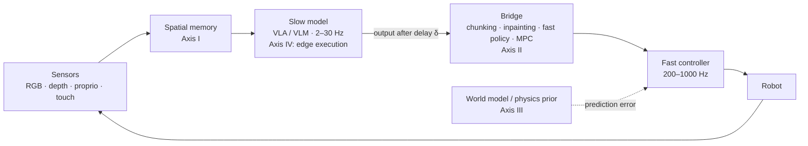

# Awesome Neuro-Physical VLA 

A curated, taxonomy-tagged list of work on **making vision-language-action models run on real robots in real time**: spatial representations, how slow model outputs reach fast actuators, world models and physical priors, and edge execution.

<!-- BEGIN:stats -->
*37 papers · last generated 2026-10-25. † = listed but not yet checked against the paper.*
<!-- END:stats -->

## Why this list

Large vision-language-action models typically return commands at a few to a few tens of hertz, with tens to hundreds of milliseconds between observation and action. Contact and agile motion need feedback at hundreds of hertz. Most VLA papers handle the gap implicitly, by executing open-loop action chunks and assuming the scene holds still while the model thinks.

This list is organized around that gap. Every entry is tagged with the part of the loop it changes, and timing numbers appear only with the hardware, precision and source needed to compare them.

## Contents

- [Taxonomy](#taxonomy)
- [Timing table](#timing-table)
- [Papers](#papers)
- [Contributing](#contributing)
- [Citation](#citation)

## Taxonomy

Each paper gets one primary code (where it is listed) and optional secondary codes (shown as tags). Full definitions and borderline cases are in [docs/taxonomy.md](docs/taxonomy.md).

<!-- BEGIN:overview -->
| Axis | Code | Category | Assign a paper here if… |
| :--- | :--- | :--- | :--- |
| I. Spatial representation and memory | `1A` | 2D patch tokens | Policy consumes ViT/CNN patch features of RGB frames only. |
| I. Spatial representation and memory | `1B` | Explicit 3D input | Point cloud, voxel grid, or lifted features with metric geometry. |
| I. Spatial representation and memory | `1C` | 3D-aware encodings on 2D backbones | 2D tokens plus depth or 3D position encodings; no persistent 3D structure. |
| I. Spatial representation and memory | `1D` | Persistent 3D scene memory | A 3D representation persists across frames (fusion, Gaussians, feature fields). Note online vs offline construction. |
| II. Execution timing and delay compensation | `2A` | Synchronous chunk execution | Chunk executed open-loop while the next inference waits or uses a frozen observation. |
| II. Execution timing and delay compensation | `2B` | Chunk smoothing and ensembling | Overlapping chunks blended (temporal ensembling and successors). |
| II. Execution timing and delay compensation | `2C` | Asynchronous chunk inpainting | Next chunk generated during execution, conditioned on the executed prefix. |
| II. Execution timing and delay compensation | `2D` | Dual-system learned fast policy | A separate fast network consumes a slow latent at a higher rate. |
| II. Execution timing and delay compensation | `2E` | Model-based bridges | Stale output propagated with a model and tracked by MPC/QP. |
| II. Execution timing and delay compensation | `2F` | Safety filters | CBF, HJ reachability or similar layer overrides the learned command. |
| III. World models and physical priors | `3A` | Pixel and video world models | Predicts future RGB frames or video latents. |
| III. World models and physical priors | `3B` | Flow, track and pose models | Predicts 2D/3D point tracks, scene flow or object poses. |
| III. World models and physical priors | `3C` | Analytic, differentiable and residual physics | Physics prior plus learned or adaptive residual, or simulation used for skill learning. |
| IV. Edge execution | `4A` | Quantization | Reduced-precision weights, activations or KV cache. |
| IV. Edge execution | `4B` | Token reduction, caching, early exit | Fewer tokens or layers per step. |
| IV. Edge execution | `4C` | Alternative backbones | State-space or recurrent models replace attention. |
| IV. Edge execution | `4D` | Small and distilled policies | Compact model by design or distilled from a larger teacher. |
| IV. Edge execution | `4E` | Runtime, scheduling and solvers | Pipelining, async runtimes, zero-copy memory, embedded optimization solvers. |
<!-- END:overview -->

## Timing table

Latency numbers from different papers are rarely comparable: they use different GPUs, precisions, batch sizes, and include or exclude preprocessing. A row is shown here only if it states all of these and points to its source. *Reported* rows come from papers; *measured* rows come from runs logged in this repository. The standard is in [docs/latency-reporting.md](docs/latency-reporting.md).

<!-- BEGIN:latency -->
*No verified timing records yet. Every row needs the device, precision, what was timed, and a pointer to the source table or log; see [docs/latency-reporting.md](docs/latency-reporting.md).*
<!-- END:latency -->

## Papers

Within each category, newest first.

<!-- BEGIN:papers -->
### Axis I: Spatial representation and memory

*How streaming 2D, depth and point data become the spatial state a policy reads.*

#### `1A` 2D patch tokens

- **OpenVLA: An Open-Source Vision-Language-Action Model** †  
  Kim et al. · *CoRL 2024* · 2024 · [arXiv](https://arxiv.org/abs/2406.09246) · [code](https://github.com/openvla/openvla) · `1A` `2A` `4A`  
  Open 7B autoregressive VLA; reports quantized inference, making it the usual baseline for edge latency studies.
- **RT-2: Vision-Language-Action Models Transfer Web Knowledge to Robotic Control** †  
  Brohan et al. · *CoRL 2023* · 2023 · [arXiv](https://arxiv.org/abs/2307.15818) · `1A` `2A`  
  Co-fine-tunes a web-scale VLM to emit discretized actions as text tokens; the reference point for monolithic VLAs.

#### `1B` Explicit 3D input

- **3D Diffusion Policy: Generalizable Visuomotor Policy Learning via Simple 3D Representations** †  
  Ze et al. · *RSS 2024* · 2024 · [arXiv](https://arxiv.org/abs/2403.03954) · `1B` `2A`  
  Conditions a diffusion policy on a compact encoding of a sparse point cloud; strong sample efficiency over image inputs.
- **3D-VLA: A 3D Vision-Language-Action Generative World Model** †  
  Zhen et al. · *ICML 2024* · 2024 · [arXiv](https://arxiv.org/abs/2403.09631) · `1B` `3A`  
  3D-grounded VLA that also generates goal images and point clouds as an embodied world model.
- **Perceiver-Actor: A Multi-Task Transformer for Robotic Manipulation** †  
  Shridhar, Manuelli, Fox · *CoRL 2022* · 2022 · [arXiv](https://arxiv.org/abs/2209.05451) · `1B`  
  Voxelized observation and action space with a Perceiver transformer; predicts next keyframe poses.

#### `1C` 3D-aware encodings on 2D backbones

- **SpatialVLA: Exploring Spatial Representations for Visual-Language-Action Model** †  
  Qu et al. · *RSS 2025* · 2025 · [arXiv](https://arxiv.org/abs/2501.15830) · `1C`  
  Adds egocentric 3D position encodings to 2D visual tokens and adaptive action grids; no persistent 3D memory.

#### `1D` Persistent 3D scene memory

- **SplatSim: Zero-Shot Sim2Real Transfer of RGB Manipulation Policies Using Gaussian Splatting** †  
  Qureshi et al. · *arXiv* · 2024 · [arXiv](https://arxiv.org/abs/2409.10161) · `1D` `T1`  
  Uses Gaussian splatting as a renderer to produce photorealistic training data in simulation; an offline data-generation use of 3DGS.

### Axis II: Execution timing and delay compensation

*How slow model outputs reach fast actuators without stalling or drifting.*

#### `2A` Synchronous chunk execution

- **Fine-Tuning Vision-Language-Action Models: Optimizing Speed and Success** †  
  Kim, Finn, Liang · *RSS 2025* · 2025 · [arXiv](https://arxiv.org/abs/2502.19645) · `2A` `4B`  
  Parallel decoding with action chunking and continuous actions; large throughput gains over autoregressive OpenVLA.
- **π0: A Vision-Language-Action Flow Model for General Robot Control** †  
  Black et al. · *RSS 2025* · 2024 · [arXiv](https://arxiv.org/abs/2410.24164) · [code](https://github.com/Physical-Intelligence/openpi) · `2A` `1A`  
  VLM backbone plus a flow-matching action expert producing continuous action chunks; executes chunks synchronously by default.
- **Diffusion Policy: Visuomotor Policy Learning via Action Diffusion** †  
  Chi et al. · *RSS 2023* · 2023 · [arXiv](https://arxiv.org/abs/2303.04137) · `2A`  
  Denoising diffusion over action sequences with receding-horizon execution; denoising steps set its latency.
- **Learning Fine-Grained Bimanual Manipulation with Low-Cost Hardware** †  
  Zhao et al. · *RSS 2023* · 2023 · [arXiv](https://arxiv.org/abs/2304.13705) · `2A` `2B`  
  Introduces Action Chunking with Transformers (ACT) and temporal ensembling of overlapping chunks.

#### `2C` Asynchronous chunk inpainting

- **Real-Time Execution of Action Chunking Flow Policies** †  
  Black, Galliker, Levine · *arXiv* · 2025 · [arXiv](https://arxiv.org/abs/2506.07339) · `2C`  
  Generates the next chunk while the current one executes, treating continuity with already-committed actions as inference-time inpainting.

#### `2D` Dual-system learned fast policy

- **GR00T N1: An Open Foundation Model for Generalist Humanoid Robots** †  
  NVIDIA et al. · *arXiv* · 2025 · [arXiv](https://arxiv.org/abs/2503.14734) · `2D`  
  Dual-system VLA: a vision-language module conditions a diffusion-transformer action module running at a higher rate.
- **Helix: A Vision-Language-Action Model for Generalist Humanoid Control** †  
  Figure AI · *Blog* · 2025 · [page](https://www.figure.ai/news/helix) · `2D`  
  Industrial dual-system design: a slower VLM feeds a latent to a fast visuomotor policy. Technical report, not peer reviewed.

#### `2E` Model-based bridges

- **Learning High-Speed Flight in the Wild** †  
  Loquercio et al. · *Science Robotics* · 2021 · [arXiv](https://arxiv.org/abs/2110.05113) · `2E`  
  Sensorimotor policy for agile flight that maps sensing to receding-horizon trajectories with low end-to-end latency.

### Axis III: World models and physical priors

*Predictive models of what actions do, and how prediction error is used.*

#### `3A` Pixel and video world models

- **Genie: Generative Interactive Environments** †  
  Bruce et al. · *ICML 2024* · 2024 · [arXiv](https://arxiv.org/abs/2402.15391) · `3A`  
  Action-controllable video world model learned from unlabeled video with latent actions; far from control-loop rates.
- **Learning Universal Policies via Text-Guided Video Generation** †  
  Du et al. · *NeurIPS 2023* · 2023 · [arXiv](https://arxiv.org/abs/2302.00111) · `3A`  
  Plans by generating a video of the task, then recovers actions with an inverse dynamics model.

#### `3B` Flow, track and pose models

- **Any-point Trajectory Modeling for Policy Learning** †  
  Wen et al. · *RSS 2024* · 2024 · [arXiv](https://arxiv.org/abs/2401.00025) · `3B`  
  Predicts future trajectories of arbitrary image points and conditions the policy on them.
- **General Flow as Foundation Affordance for Scalable Robot Learning** †  
  Yuan et al. · *CoRL 2024* · 2024 · [arXiv](https://arxiv.org/abs/2401.11439) · `3B`  
  Predicts 3D point flow as an embodiment-agnostic intermediate representation for manipulation.
- **Track2Act: Predicting Point Tracks from Internet Videos enables Generalizable Robot Manipulation** †  
  Bharadhwaj et al. · *ECCV 2024* · 2024 · [arXiv](https://arxiv.org/abs/2405.01527) · `3B` `3C`  
  Predicts point tracks from web video and corrects the resulting open-loop plan with a learned residual policy.

#### `3C` Analytic, differentiable and residual physics

- **Gen2Sim: Scaling up Robot Learning in Simulation with Generative Models** †  
  Katara, Xian, Fragkiadaki · *arXiv* · 2023 · [arXiv](https://arxiv.org/abs/2310.18308) · `3C` `T1`  
  Generates simulation assets and tasks with generative models to scale skill learning in simulation.
- **TossingBot: Learning to Throw Arbitrary Objects with Residual Physics** †  
  Zeng et al. · *IEEE T-RO* · 2020 · [arXiv](https://arxiv.org/abs/1903.11239) · `3C`  
  Analytical projectile model plus a learned residual for throwing; the canonical residual-physics example.

### Axis IV: Edge execution

*Making the models fit the latency, memory and power budget of onboard hardware.*

#### `4A` Quantization

- **AWQ: Activation-aware Weight Quantization for LLM Compression and Acceleration** †  
  Lin et al. · *MLSys 2024* · 2024 · [arXiv](https://arxiv.org/abs/2306.00978) · `4A`  
  Weight-only low-bit quantization guided by activation statistics; widely used for VLM backbones on edge GPUs.
- **SmoothQuant: Accurate and Efficient Post-Training Quantization for Large Language Models** †  
  Xiao et al. · *ICML 2023* · 2023 · [arXiv](https://arxiv.org/abs/2211.10438) · `4A`  
  Moves activation outliers into weights so both can use 8-bit; W8A8 inference for transformer backbones.

#### `4C` Alternative backbones

- **RoboMamba: Efficient Vision-Language-Action Model for Robotic Reasoning and Manipulation** †  
  Liu et al. · *NeurIPS 2024* · 2024 · [arXiv](https://arxiv.org/abs/2406.04339) · `4C`  
  Mamba backbone in place of attention for a VLA, targeting lower inference cost.
- **Liquid Time-constant Networks** †  
  Hasani et al. · *AAAI 2021* · 2021 · [arXiv](https://arxiv.org/abs/2006.04439) · `4C`  
  Continuous-time recurrent cells with input-dependent time constants; compact controllers for streaming input.

#### `4D` Small and distilled policies

- **SmolVLA: A Vision-Language-Action Model for Affordable and Efficient Robotics** †  
  Shukor et al. · *arXiv* · 2025 · [arXiv](https://arxiv.org/abs/2506.01844) · [code](https://github.com/huggingface/lerobot) · `4D` `2C`  
  Small VLA with an asynchronous inference stack that decouples action prediction from execution.
- **TinyVLA: Towards Fast, Data-Efficient Vision-Language-Action Models for Robotic Manipulation** †  
  Wen et al. · *IEEE RA-L* · 2025 · [arXiv](https://arxiv.org/abs/2409.12514) · `4D`  
  Compact VLAs (roughly 0.4B to 1.3B parameters) with a diffusion action head; faster inference than 7B VLAs.

#### `4E` Runtime, scheduling and solvers

- **TinyMPC: Model-Predictive Control on Resource-Constrained Microcontrollers** †  
  Nguyen, Schoedel, Alatur, Manchester · *ICRA 2024* · 2024 · [arXiv](https://arxiv.org/abs/2310.16985) · [code](https://github.com/TinyMPC/TinyMPC) · `4E` `2E`  
  ADMM-based convex MPC solver small and fast enough for microcontrollers; a building block for fast tracking loops under a slow planner.

### Simulators, benchmarks and infrastructure

*Where and how these systems are trained and measured.*

#### `T1` Simulators

- **Isaac Lab** †  
  NVIDIA · *Software* · 2024 · [page](https://github.com/isaac-sim/IsaacLab) · `T1`  
  Robot-learning framework on Isaac Sim with GPU-parallel environments.
- **ManiSkill3: GPU Parallelized Robotics Simulation and Rendering for Generalizable Embodied AI** †  
  Tao et al. · *arXiv* · 2024 · [arXiv](https://arxiv.org/abs/2410.00425) · [code](https://github.com/haosulab/ManiSkill) · `T1`  
  GPU-parallel simulation and rendering for manipulation; fast enough for large-scale policy training and evaluation.

#### `T2` Benchmarks and evaluation

- **Wake Vision: A Tailored Dataset and Benchmark Suite for TinyML Computer Vision Applications** †  
  Banbury et al. · *arXiv* · 2024 · [arXiv](https://arxiv.org/abs/2405.00892) · `T2` `4D`  
  Person-detection dataset and benchmark for microcontroller-scale vision models; a reference for the TinyML end of the spectrum.

#### `T3` Training infrastructure

- **RLinf-VLA: A Unified and Efficient Framework for VLA+RL Training** †  
  RLinf team · *arXiv* · 2025 · [page](https://github.com/RLinf/RLinf) · `T3`  
  Infrastructure for reinforcement-learning fine-tuning of VLAs. Check title and arXiv id.

### Related surveys

*Surveys this list builds on or differs from.*

#### `S1` Surveys

- **A Comprehensive Survey on World Models for Embodied AI** †  
  Li et al. · *arXiv* · 2025 · [arXiv](https://arxiv.org/abs/2510.16732) · `S1`  
  Three-axis taxonomy of world models: functionality, temporal modeling, spatial representation.
- **A Survey on Efficient Vision-Language-Action Models** †  
  Yu et al. · *arXiv* · 2025 · [arXiv](https://arxiv.org/abs/2510.24795) · `S1`  
  Efficiency across model design, training and data collection.
- **Efficient Vision-Language-Action Models for Embodied Manipulation: A Systematic Survey** †  
  Guan et al. · *arXiv* · 2025 · [arXiv](https://arxiv.org/abs/2510.17111) · `S1`  
  Efficiency techniques for edge deployment of VLAs.
- **A Survey on Vision-Language-Action Models for Embodied AI** †  
  Ma et al. · *arXiv* · 2024 · [arXiv](https://arxiv.org/abs/2405.14093) · `S1`  
  Broad VLA taxonomy: components, low-level policies, high-level planners.
<!-- END:papers -->

## Contributing

Additions and corrections are welcome. Edit [`data/papers.yaml`](data/papers.yaml) (not this README), run `python scripts/validate.py`, and open a pull request; the README is regenerated from the data. Details, including how to submit a timing record, are in [CONTRIBUTING.md](CONTRIBUTING.md). If you are an author and your paper is miscategorized or described inaccurately, please open an issue.

## Citation

If this list helps your work, you can cite it using the metadata in [CITATION.cff](CITATION.cff) (GitHub shows a "Cite this repository" button).

## Maintainer

Maintained by [Prithvi Raj Singh](https://prithviraj97.github.io/), University of Louisiana at Lafayette.

## License

The list and data are released under CC0 1.0. Scripts are under the MIT license (see `scripts/LICENSE`).
