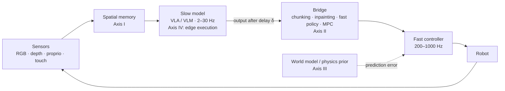

# Awesome Neuro-Physical VLA 

A curated, taxonomy-tagged list of work on **making vision-language-action models run on real robots in real time**: spatial representations, how slow model outputs reach fast actuators, world models and physical priors, and edge execution.

<!-- BEGIN:stats -->
*0 papers · last generated 2026-11-01.*
<!-- END:stats -->

## Why this list

Large vision-language-action models typically return commands at a few to a few tens of hertz, with tens to hundreds of milliseconds between observation and action. Contact and agile motion need feedback at hundreds of hertz. Most VLA papers handle the gap implicitly, by executing open-loop action chunks and assuming the scene holds still while the model thinks.

This list is organized around that gap. Every entry is tagged with the part of the loop it changes, and timing numbers appear only with the hardware, precision and source needed to compare them.

## Contents

- [Taxonomy](#taxonomy)
- [Timing table](#timing-table)
- [Papers](#papers)
- [Contributing](#contributing)
- [Citation](#citation)

## Taxonomy

Each paper gets one primary code (where it is listed) and optional secondary codes (shown as tags). Full definitions and borderline cases are in [docs/taxonomy.md](docs/taxonomy.md).

<!-- BEGIN:overview -->
| Axis | Code | Category | Assign a paper here if… |
| :--- | :--- | :--- | :--- |
| I. Spatial representation and memory | `1A` | 2D patch tokens | Policy consumes ViT/CNN patch features of RGB frames only. |
| I. Spatial representation and memory | `1B` | Explicit 3D input | Point cloud, voxel grid, or lifted features with metric geometry. |
| I. Spatial representation and memory | `1C` | 3D-aware encodings on 2D backbones | 2D tokens plus depth or 3D position encodings; no persistent 3D structure. |
| I. Spatial representation and memory | `1D` | Persistent 3D scene memory | A 3D representation persists across frames (fusion, Gaussians, feature fields). Note online vs offline construction. |
| II. Execution timing and delay compensation | `2A` | Synchronous chunk execution | Chunk executed open-loop while the next inference waits or uses a frozen observation. |
| II. Execution timing and delay compensation | `2B` | Chunk smoothing and ensembling | Overlapping chunks blended (temporal ensembling and successors). |
| II. Execution timing and delay compensation | `2C` | Asynchronous chunk inpainting | Next chunk generated during execution, conditioned on the executed prefix. |
| II. Execution timing and delay compensation | `2D` | Dual-system learned fast policy | A separate fast network consumes a slow latent at a higher rate. |
| II. Execution timing and delay compensation | `2E` | Model-based bridges | Stale output propagated with a model and tracked by MPC/QP. |
| II. Execution timing and delay compensation | `2F` | Safety filters | CBF, HJ reachability or similar layer overrides the learned command. |
| III. World models and physical priors | `3A` | Pixel and video world models | Predicts future RGB frames or video latents. |
| III. World models and physical priors | `3B` | Flow, track and pose models | Predicts 2D/3D point tracks, scene flow or object poses. |
| III. World models and physical priors | `3C` | Analytic, differentiable and residual physics | Physics prior plus learned or adaptive residual, or simulation used for skill learning. |
| IV. Edge execution | `4A` | Quantization | Reduced-precision weights, activations or KV cache. |
| IV. Edge execution | `4B` | Token reduction, caching, early exit | Fewer tokens or layers per step. |
| IV. Edge execution | `4C` | Alternative backbones | State-space or recurrent models replace attention. |
| IV. Edge execution | `4D` | Small and distilled policies | Compact model by design or distilled from a larger teacher. |
| IV. Edge execution | `4E` | Runtime, scheduling and solvers | Pipelining, async runtimes, zero-copy memory, embedded optimization solvers. |
<!-- END:overview -->

## Timing table

Latency numbers from different papers are rarely comparable: they use different GPUs, precisions, batch sizes, and include or exclude preprocessing. A row is shown here only if it states all of these and points to its source. *Reported* rows come from papers; *measured* rows come from runs logged in this repository. The standard is in [docs/latency-reporting.md](docs/latency-reporting.md).

<!-- BEGIN:latency -->
*No verified timing records yet. Every row needs the device, precision, what was timed, and a pointer to the source table or log; see [docs/latency-reporting.md](docs/latency-reporting.md).*
<!-- END:latency -->

## Papers

Within each category, newest first.

<!-- BEGIN:papers -->
### Axis I: Spatial representation and memory

*How streaming 2D, depth and point data become the spatial state a policy reads.*

### Axis II: Execution timing and delay compensation

*How slow model outputs reach fast actuators without stalling or drifting.*

### Axis III: World models and physical priors

*Predictive models of what actions do, and how prediction error is used.*

### Axis IV: Edge execution

*Making the models fit the latency, memory and power budget of onboard hardware.*

### Simulators, benchmarks and infrastructure

*Where and how these systems are trained and measured.*

### Related surveys

*Surveys this list builds on or differs from.*
<!-- END:papers -->

## Contributing

Additions and corrections are welcome. Edit [`data/papers.yaml`](data/papers.yaml) (not this README), run `python scripts/validate.py`, and open a pull request; the README is regenerated from the data. Details, including how to submit a timing record, are in [CONTRIBUTING.md](CONTRIBUTING.md). If you are an author and your paper is miscategorized or described inaccurately, please open an issue.

## Citation

If this list helps your work, you can cite it using the metadata in [CITATION.cff](CITATION.cff) (GitHub shows a "Cite this repository" button).

## Maintainer

Maintained by [Prithvi Raj Singh](https://prithviraj97.github.io/), University of Louisiana at Lafayette.

## License

The list and data are released under CC0 1.0. Scripts are under the MIT license (see `scripts/LICENSE`).
